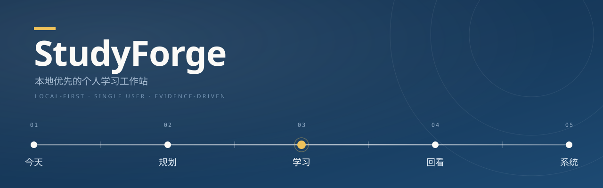
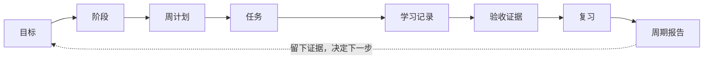
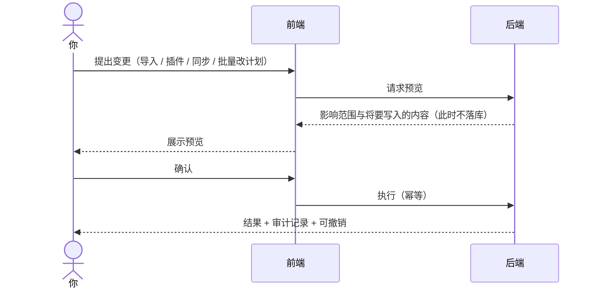

# StudyForge

**把「今天该学什么」和「我到底学到了什么」，放在同一张桌上。**


> 单用户 · 本地优先 · 数据默认不出本机

StudyForge（Learning Workstation）是你自己机器上的一间学习工坊。界面用 React/TypeScript + Vite，记忆交给 FastAPI + SQLite——目标、阶段、周计划、任务、学习记录、笔记、知识主题、复习和 Agent 对话，都串成一条能回头看的线。

学习数据默认存放在仓库之外；云端模型、多设备同步和系统通知默认全部关闭，等你亲手打开。

它不做什么：不是课程平台，不是通用聊天机器人，也不是打卡看板。



---

## 一张图看懂：学习闭环



每一步都留下证据，下一个决定才有依据。打卡数量不是目标；能拿出产出和验收记录，才算真的前进。

## 三个设计选择

它和普通学习工具的区别不在功能多少，而在这三个刻意的取舍。

### 1. 证据在前，建议在后

系统把三类东西分开放：你自己确认的事实、系统统计出的数字、模型提出的建议。学习报告基于已保存的证据生成，并持久化源数据快照；建议一律标记为「需确认」，不会自动修改你的任务。原始学习记录永久保留，模型输出只能成为候选。

### 2. 双模型，按任务路由

不是「随机挑一个模型」，而是按任务类型分流：

| 任务 | 默认模型 | 原因 |
|---|---|---|
| 学习记录结构化、格式化、摘要、分类、闪卡、文件索引 | 本地 Ollama（`qwen35-9b-local:latest`） | 低成本、低延迟、学习原文默认不出本机 |
| 技术写作、学习规划、深度讲解、知识体系分析 | 云端 `gpt-5.6-luna`（zhiapi） | 需要更强的长文本组织、推理和表达能力 |
| 代码审查、文件云端分析、批量计划变更 | 云端（需显式确认） | 可能涉及更大范围数据或产生外部影响 |

云端调用有四道保护：

1. 云端默认关闭；
2. 文件云端分析必须经过前端「预览 → 确认」；
3. 最终出站前脱敏常见密钥、邮箱和手机号，并按正文上限裁剪；
4. 每日调用次数与费用受限。

文件云端分析不发送原始绝对路径。云端未配置时不会自动上传，也不会把云端任务静默改成本地结构化任务。Agent 对学习计划的结构化修改，同样必须经过「预览 → 确认 → 执行」。

<details>
<summary><b>启用云端模型（可选，3 步）</b></summary>

1. 复制根目录模板：`cp .env.example .env`（Windows 也可手动复制）。
2. 在 `.env` 中填写新生成的 zhiapi Key，不要使用历史泄露的 Key：

```dotenv
CLOUD_MODEL_ENABLED=true
CLOUD_MODEL_BASE_URL=https://zhi-api.com/v1
CLOUD_MODEL_NAME=gpt-5.6-luna
CLOUD_MODEL_API_KEY=你的新密钥
```

3. 重启后端，然后访问「模型任务」页面。写作、规划、深度讲解和知识分析会显示实际 provider/model。

</details>

### 3. 高风险写入：预览 → 确认 → 执行



导入、插件、同步、批量计划变更都走这条路。任何自动化都必须保持用户控制、来源可追溯、失败可恢复。

## 五个工作域

导航就是这个结构，每天通常只打开一两个。

| 域 | 你能做什么 |
|---|---|
| **今天** | 今日总览、学习记录，以及驾驶舱按学习信号给出的下一步建议 |
| **规划** | 目标 / 阶段 / 任务、周计划与周复盘、项目工作台、岗位分析、模拟面试 |
| **学习** | 练习与沙箱、笔记库（版本快照、博客草稿）、知识地图、教学闭环、学习伙伴 |
| **回看** | 今日复习、复习卡片（SM-2 风格调度）、能力画像、学习报告、统计复盘 |
| **系统** | 初始化向导、文件导入、备份恢复、模型任务、插件系统、运行与审计 |

**已接通**：主要学习闭环、项目工作台、GitHub 提交分析、模拟面试、求职岗位分析、移动端独立体验、加密多设备同步包、WebDAV 云同步、声明式插件系统。

**可选、默认关闭**：云端模型、本地 Ollama、Web Push 后台提醒、Windows 原生通知。

**待外部联调**：真实 HTTPS WebDAV、云端模型、Web Push VAPID 与浏览器权限、Windows 通知权限。

---

## 功能细节

默认折叠。按你关心的部分展开——

<details>
<summary><b>计划、任务与验收</b></summary>

- 「学习计划」页面：创建目标、阶段和任务；支持未开始、进行中、待验证、已完成、需要复习、已掌握、已暂停和已调整状态；可填写验收标准、实际用时，并提交带证据的验收记录；可查看最近三条验收历史。
- 任务计时器：开始、暂停、继续、停止，多段时间片由服务端累计，刷新页面后可恢复运行状态，停止后自动同步任务实际用时。
- 新任务先经过影响评估再确认写入，评估主线关系、前置知识和本周计划负荷；Agent 任务预览复用同一接口。`POST /api/tasks/impact-preview` 在创建任务前返回目标/阶段/主题/项目关系、前置知识、本周预计用时和影响等级，不写入任何数据。
- Agent 的单任务、批量任务和撤销流程共用同一状态机。
- 动态计划调整：Agent 可根据逾期任务、今日负载、待复习和待整理记录生成动态计划调整提案；调整前展示影响范围，确认后批量执行，手动修改冲突会被跳过并记录审计。
- 周计划与周复盘：任务支持 `week_key`、任务类型、预期结果、Agent 评价、验收标准、实际用时、完成时间、最后验证时间和下次复习日期；任务状态由后端显式校验合法流转，验收记录保存可复核证据并写入审计；前端提供周计划与周复盘视图，可保存周目标、周产出、复盘和阻塞；后端提供周计划摘要、完成率、学习产出和时间统计。
- 学习驾驶舱：展示待复习知识点、薄弱能力、进行中项目、最近笔记和按学习信号生成的 Agent 建议，并明确比较近 7 天与前 7 天的学习时长、产出、验收任务和新增笔记，回答最近是否产生实际进步。
- 首次启动向导：按「画像预览 → 首个学习主线确认 → 显式授权目录 → 本地扫描 → 导入报告预览 → 确认写入」推进；资料导入可跳过，向导中的云端发送和写入权限固定关闭，后续可在「文件导入」页单独调整；向导重复打开不会自动扫描或改写数据。

</details>

<details>
<summary><b>笔记、知识地图与搜索</b></summary>

- 学习伙伴（AI 教练）：聊天以增量 SSE 展示回答，并区分解释、建议和操作，显示依据与不确定性；结论可分别预览并确认转换为笔记草稿、学习任务或知识点；对话之外提供 Agent 变更预览和确认执行，支持任务、笔记、知识主题、项目、复习和批量任务变更。
- 笔记自动保存版本快照，支持版本列表和恢复（`/api/notes/{id}/versions` 与版本恢复接口）。
- 博客草稿：先预览再确认保存，保留来源笔记和版本快照，不覆盖原笔记、不自动发布，并支持 Markdown/TXT/HTML 导出。
- 知识地图：支持主题关系创建、删除，以及薄弱点 / 孤立点 / 实践缺口分析；导入确认后会建立笔记与主题关联。
- 项目、任务、日志、笔记和知识主题支持结构化关联；项目支持里程碑字段。
- 全局搜索：支持任务、学习日志、笔记、知识主题、项目和已导入文件，并提供统一结果分组与工作区跳转。
- 首页导出菜单：可将全部目标、阶段、任务、学习记录、笔记、知识主题和项目导出为 Markdown、TXT 或 HTML 阅读版；笔记导出同时兼容 `md` 路径别名。

</details>

<details>
<summary><b>复习、能力画像与报告</b></summary>

- 今日复习：支持质量评分、间隔更新、难度因子和知识掌握度变化。
- 复习卡片：支持手动创建、按笔记生成、到期查询、作答评分、编辑、归档、软删除、批量管理、复习历史和统计，使用带失败降级与 ease factor 更新的 SM-2 风格调度；支持按错误类型、主题和日期分析及补救建议。关键接口：`/api/review-cards`、`/api/review-cards/due`、`/api/review-cards/stats`、`/api/review-cards/bulk`、`/api/review-cards/generate`、`/api/review-cards/{id}/answer`、`/api/review-cards/{id}/history`。
- 能力画像：支持等级、置信度、证据数量、证据详情展示和重新评估；能力 API 根据任务、日志、项目、知识主题和教学作答证据生成能力画像，并保存成长曲线证据；可查看评估历史并确认执行补强计划。
- 统计复盘：支持按日趋势、主题维度、能力成长和模型 Token/成本汇总。
- 学习报告：基于已保存证据生成并持久化源数据快照，建议标记为需确认，不会自动修改任务；支持日报、周报、阶段报告、瓶颈分析、历史、详情及 JSON/Markdown/TXT/HTML 导出。接口：`POST /api/reports/{daily|weekly|stage|bottleneck}/generate`、`GET /api/reports`、`GET /api/reports/{id}`、`GET /api/reports/{id}/export/{json|txt|md|html}`；默认按报告类型与周期幂等复用，显式 `force_new_version` 创建新版本；报告默认使用确定性统计，设置 `REPORT_MODEL_ENHANCEMENT_ENABLED=true` 后才启用本地结构化模型增强，失败会回退到确定性统计。

</details>

<details>
<summary><b>教学闭环、练习与项目</b></summary>

- 「教学闭环」页面：支持创建教学会话、关联知识主题/任务/阶段、生成讲解与练习、提交作答、结构化模型评价、错误类型识别、覆盖/缺失要点、置信度、针对性反馈和薄弱点复习卡片推荐；模型失败或低置信度时回退到本地确定性评价；教学会话、教学练习、作答、评分、反馈和复习卡片关联均会持久化。
- 「练习与沙箱」：支持算法 stdin/stdout、隔离 SQLite SQL 校验和受限 Python 执行。
- 项目：支持独立里程碑实体、看板、时间线和成果证据。新增实体同时进入 JSON 导出、备份恢复、审计与可撤销恢复链路。

</details>

<details>
<summary><b>求职训练</b></summary>

- 项目工作台：支持 GitHub 仓库关联、提交元数据同步、文件名/行数统计和确定性学习分析，所有导入与分析均需预览确认且不保存源码或 patch。
- 模拟面试：独立入口，复用教学会话的回答、结构化评价和复习建议链路。
- 岗位分析：粘贴岗位描述后预览技能关键词、本地知识主题/能力/项目证据匹配、缺口和补强建议；确认后保存分析快照，不自动改变能力等级或项目状态，结果进入导出、备份和字段级合并链路。

</details>

<details>
<summary><b>导入、同步、通知与插件</b></summary>

- 文件导入：支持 Markdown、TXT、JSON/YAML、CSV、HTML、PDF、DOCX 和常见代码正文索引；授权目录必须由用户显式添加，前端可维护扩展名白名单、排除扩展名和排除路径模式，并支持扫描启停、授权时间、撤销时间、最近扫描时间和基于两次目录扫描的新增/修改/删除提醒；提醒可查询并标记已读，不会自动修改学习计划。PDF 使用 `pypdf`，DOCX 使用标准库解析，解析失败时安全回退为 `metadata_only`。
- 分层存储：原始副本、正文、导入索引和分析结果分别保存到 `data/imports/raw/`、`content/`、`index/`、`analysis/`，SQLite 仅保存元数据、相对路径和哈希；支持「预览 → 确认 → 执行」、自动创建知识主题、来源笔记与幂等重复确认。完整备份保留文件化引用，实际 `data/imports/` 目录必须一并备份。完整性检测走 `GET /api/imports/integrity`，检查源文件、原始副本、正文、索引、分析结果的缺失/变化/哈希不匹配及孤立文件。
- 文件写入与云端分析：已接通写入与云端分析的前端预览/确认入口；云端文件分析只发送脱敏、限长正文，不发送原始绝对路径。
- 多设备同步：`POST /api/sync/export`、`POST /api/sync/preview`、`POST /api/sync/apply`；同步包使用 PBKDF2-HMAC-SHA256 派生口令密钥并用 Fernet 加密，预览只读，确认后复用可撤销的追加恢复链路；同步包支持导出、跨设备预览和确认追加，不覆盖或删除目标设备数据。
- WebDAV 云同步：`POST /api/sync/cloud/push`、`POST /api/sync/cloud/pull` 和状态查询；只上传加密同步包，支持确认后上传和拉取预览，不引入账号系统或明文云端数据；凭据只在后端环境变量中读取，上传覆盖远端包必须确认；传输层拒绝 URL 凭据、查询参数、路径穿越和超限上传；已增加本地真实 HTTP PUT/GET 回环验证，外部 WebDAV 服务端仍需在用户环境配置后联调。
- Web Push：`GET /api/push/config`、订阅注册/删除和测试接口；`WEB_PUSH_ENABLED` 默认关闭，只有配置 `WEB_PUSH_VAPID_PUBLIC_KEY`、`WEB_PUSH_VAPID_PRIVATE_KEY` 和合法 `WEB_PUSH_SUBJECT` 后才会向已授权订阅发送提醒；Service Worker 负责接收 `push` 事件并显示系统通知，发送失败或未配置时保留页面内提醒降级；前端不持有 VAPID 私钥。
- Windows 原生通知：`GET /api/native-notifications/status`、测试确认接口和设置开关；默认关闭，仅在 Windows + PowerShell 可用时启用，提醒调度会去重投递，设置和测试均需确认；后端不记录提醒正文，仅保存已投递提醒 ID 防重复；不可用系统不会伪造发送成功。
- 插件系统：`GET /api/plugins`、安装预览/确认、启停、卸载预览/确认和命令执行预览/确认；插件 v1 使用声明式 JSON manifest，只允许 `model_task` 权限，只能注册 `model_task` 命令；命令通过 `router.task_policy()` 与 `router.run_task()` 执行，复用统一模型路由，不加载插件代码、不直接写文件或学习数据；审计只保留插件元数据和输入长度，不保存用户输入或完整 prompt。
- 移动端：提供 PWA manifest、应用壳缓存、导航抽屉和在线/离线状态提示；离线状态不会伪造后端写入成功。

</details>

<details>
<summary><b>工程基础</b></summary>

- 项目以需求文档为基准持续演进；SQLite migration 当前为 v40，包含日志确认来源、文件写入批次、报告反馈、复习错误、网页资源、GitHub 仓库/提交元数据、岗位分析、项目元数据、授权目录规则、持久化 Agent turn 身份、请求幂等、provider attempt 元数据和取消/超时状态；报告保存事实、证据、成就、未完成事项、薄弱点、建议、源数据快照、生成模式和版本；导入、复习卡片生成、文件写入、Agent 变更、报告反馈、GitHub 同步、提交分析和岗位分析均保留可追溯批次或审计。迁移可重复执行且保持幂等。
- `GET /api/runtime/status` 可查看后台主动提醒调度器的线程、周期、最近执行和错误状态，不返回密钥或凭据。
- 模型结构化输出：日报解析和可选报告增强均执行 Schema 校验；本地失败按 `MODEL_MAX_RETRIES` 有限重试，低风险任务才允许云端升级；缓存带 `MODEL_CACHE_TTL_SECONDS`；`/api/models/calls` 与报告实体记录 `retry_count`、`fallback_used`、provider/model 和 route reason。
- 备份恢复已完成跨实体外键 ID 重映射：目标、阶段、项目、主题、笔记、任务、日志、复习卡片、教学会话及其子记录均不再回退使用源数据库整数 ID；未解析的必需外键会被跳过并计入 `skipped_counts`。恢复撤销按父子依赖逆序执行，并保存恢复后标量快照；恢复后被用户修改的记录不会被误删，接口返回 `conflicts`，批次状态可为 `reverted`、`partially_reverted` 或 `revert_conflict`。旧版仅保存 `created_ids` 的恢复批次仍可兼容读取。
- 后端错误统一返回 `error.code`、`error.message`、`error.status`、`error.request_id`，同时保留兼容字段 `detail`；Pydantic 校验错误和未处理异常也经过统一处理。
- 每个请求接收或生成 `X-Request-ID`，响应回传同一 ID；请求日志为结构化 JSON，包含方法、路径、状态、耗时和 request_id；响应附带基础安全头。
- 前端统一 API 层提供 `ApiError`、状态码映射以及网络/5xx 各一次的有限重试。
- `/api/settings/public` 只返回 `cloud_key_configured`，不会向浏览器返回任何 Key 片段。

</details>

---

## 5 分钟跑起来

需要 Python 3.11+、`uv` 和 Node.js。

**后端**

```powershell
cd backend
uv sync
uv run uvicorn app.main:app --reload --port 8000
```

**前端**

```bash
cd frontend
npm install
npm run dev
```

前端默认连接 `http://127.0.0.1:8000`，可通过 `VITE_API_BASE_URL` 覆盖。

**受控启动（生产或长期运行时）**

先做配置校验，再启动单 worker 后端：

```powershell
pwsh -NoProfile -File .\scripts\start-backend.ps1 -ValidateOnly
pwsh -NoProfile -File .\scripts\start-backend.ps1
pwsh -NoProfile -File .\scripts\check-runtime.ps1
```

`start-backend.ps1` 会自动探测项目虚拟环境、uv 的真实 Python、用户 Python 和 Codex 受管 Python，并检查 FastAPI 依赖；也可以通过 `PYTHON_EXECUTABLE` 指定解释器。

前端生产构建与受控预览：

```powershell
pwsh -NoProfile -File .\scripts\start-frontend.ps1 -ValidateOnly
pwsh -NoProfile -File .\scripts\start-frontend.ps1
```

后端提供 `GET /api/config/validate` 和 `GET /api/ready`。预生产/生产环境配置不完整时，应用启动失败且就绪检查返回 503；配置报告不会返回任何密钥内容。

当前单用户后台调度固定使用一个 API worker；需要暴露到其他设备时，应通过 `API_HOST`、`API_ALLOWED_HOSTS` 和 `CORS_ALLOWED_ORIGINS` 明确配置边界，不能使用 `*`。

**测试**

```powershell
cd backend
uv run pytest
```

## 数据放在哪

默认数据根目录不是仓库内的 `data/`，而是仓库同级目录：以当前项目 `C:\Codex\LearningWorkstation` 为例，是 `C:\Codex\data\`。代码通过 `backend/app/config.py` 的 `data_dir()` 统一解析该位置，避免把个人学习数据误提交进代码仓库。

| 路径 | 内容 |
|---|---|
| `C:\Codex\data\learning_workstation.db` | SQLite 数据库 |
| `C:\Codex\data\notes\` | 本地文件化笔记的预留目录；当前笔记正文主要存储在 SQLite |
| `C:\Codex\data\imports\raw\` | 授权范围内的原始文件副本 |
| `C:\Codex\data\imports\content\` | UTF-8 正文文件 |
| `C:\Codex\data\imports\index\` | 导入索引 JSON |
| `C:\Codex\data\imports\analysis\` | 确认后的分析结果 JSON |
| `C:\Codex\data\exports\` | 导出文件 |
| `C:\Codex\data\backups\` | 备份文件；数据库备份必须与 `imports/` 一起保留，才能恢复文件化导入数据 |

**备份边界**：至少同时备份 `learning_workstation.db`、`imports/`、`notes/`（如已启用文件化笔记）和 `backups/`；不要把 `.env` 或任何密钥纳入备份包。

## 安全原则

- `.env` 只在本机使用，禁止提交。
- 云端调用默认关闭；不要使用历史泄露的 API Key。
- 前端不接触任何真实 API Key。
- 第一阶段不会自动扫描 WorkBuddy 或其他目录。
- 原始学习记录永久保留，模型结果只能作为待确认内容。

## 验证边界

最近一次本地验收：

| 检查项 | 状态 |
|---|---|
| 后端全量测试 | **377 passed，3 warnings** |
| 前端 TypeScript / Vite production build | 通过 |
| E2E mock 脚本 Node 语法检查 | 通过 |
| 真实 HTTPS WebDAV 服务端 | 待联调 |
| 云端模型 | 待联调（需要你的 Key） |
| Web Push VAPID 与浏览器权限 | 待联调 |
| Windows 原生通知权限 | 待联调 |

后端回归覆盖：学习报告、日志确认分层、任务验收证据、文件授权/导入/写入撤销、批次撤销、备份恢复、加密同步包、WebDAV HTTP 回环、Web Push 订阅、插件安全边界、Windows 原生通知、教学和 Agent 状态机。

后面几项不是没做完，而是需要有真实凭据和权限才能验：拿到地址、Key 和授权后，随时可以补上。
